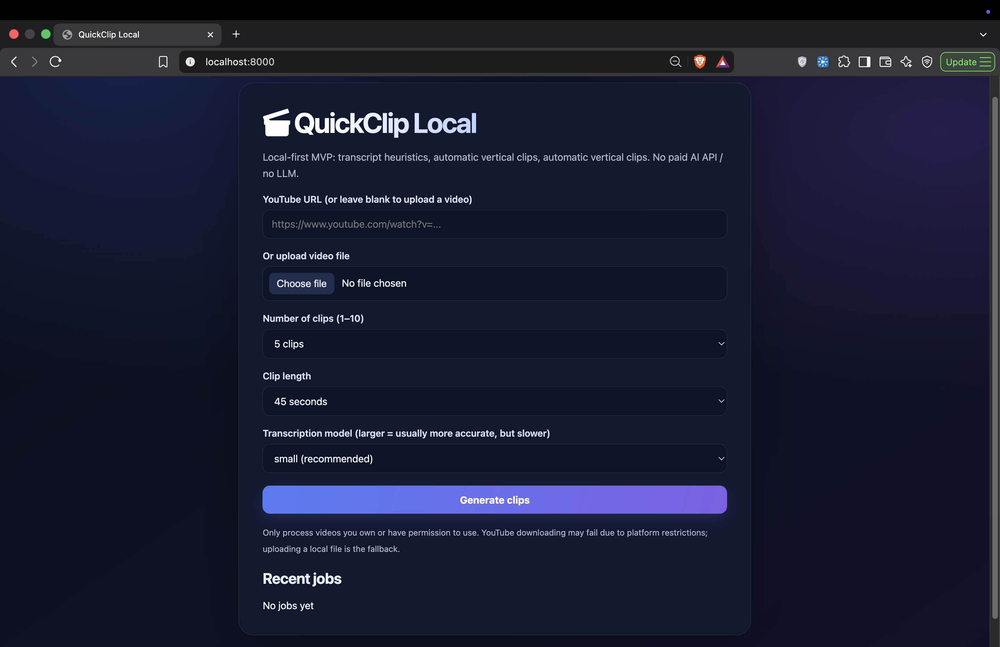
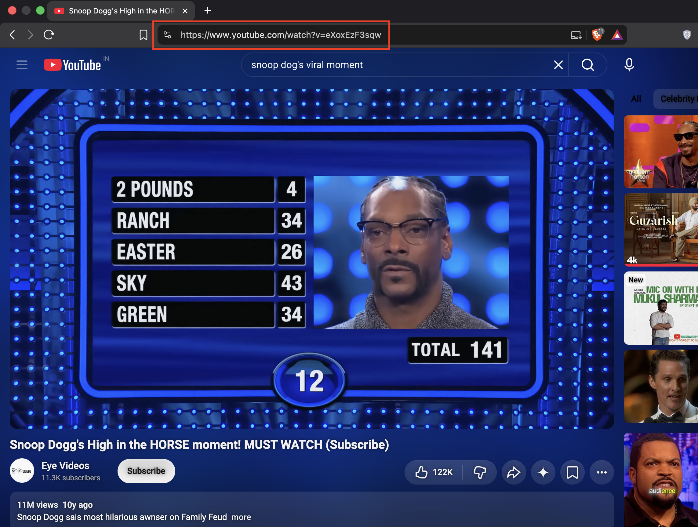
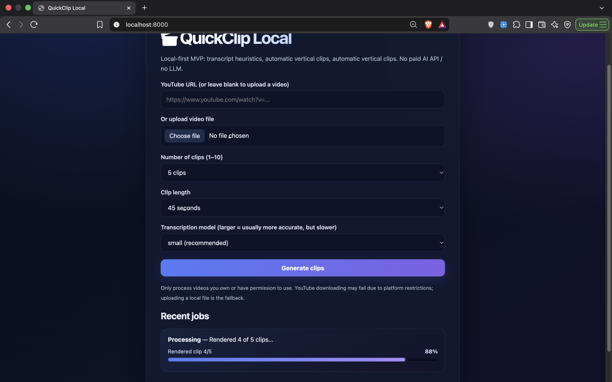
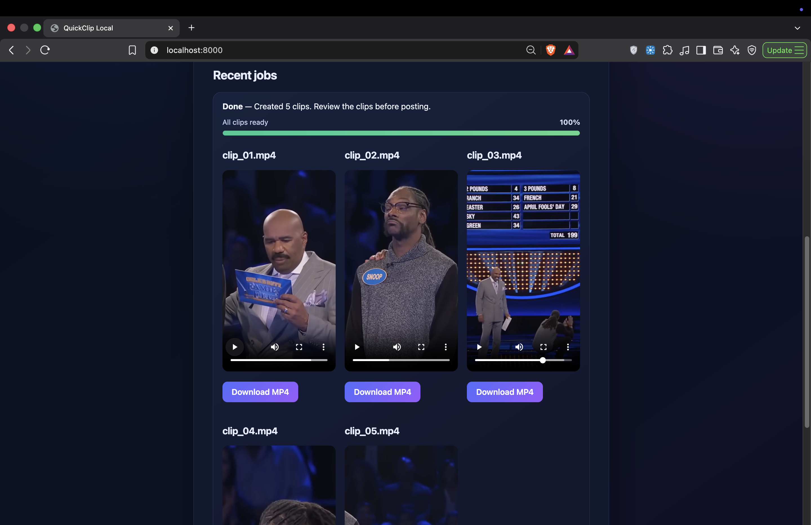

# QuickClip Local 🎬

**AI-Powered Local Video Clipping Tool**

QuickClip Local is a Python-based video clipping application that automatically transforms long-form videos into short-form vertical clips suitable for platforms like YouTube Shorts, Instagram Reels, and TikTok.

It uses speech transcription and lightweight content-selection heuristics to identify interesting moments, generate clips, and add subtitles — without requiring paid AI APIs.

## ✨ Features

- **YouTube Video Support:** Process videos using YouTube URLs.
- **Local Video Upload:** Upload your own video files.
- **Automatic Transcription:** Generate transcripts using Faster-Whisper.
- **Smart Clip Selection:** Identify potentially engaging moments using transcript-based heuristics.
- **Vertical Video Conversion:** Convert videos into a 9:16 format.
- **Subtitle Generation:** Generate and burn subtitles into clips.
- **Local Processing:** Run the application on your own machine.
- **Hindi Transliteration:** Support for Hindi transliteration.

## 📸 Application Screenshots

### 1. QuickClip Dashboard



The main dashboard of QuickClip Local, where users can access the video clipping tool and start creating short-form videos.

### 2. Copy Link



Users can paste a video URL to import content directly into the application for processing and automatic clip generation.

### 3. Processing Status



Displays the video processing progress and current task status while the application analyzes the video and generates clips.

### 4. Generated Clips



Shows the generated short video clips, which users can preview and access after the processing is complete.

## 🛠️ Tech Stack

- Python
- FastAPI
- Faster-Whisper
- OpenCV
- MediaPipe
- yt-dlp
- FFmpeg

## 📋 Requirements

- macOS
- Python 3.11
- FFmpeg
- Internet connection for initial model downloads

## 🚀 Installation

### 1. Clone the repository

```bash
git clone https://github.com/rajpurohitpushpendra/Clipping-Tool.git
cd Clipping-Tool